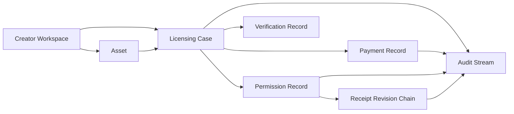
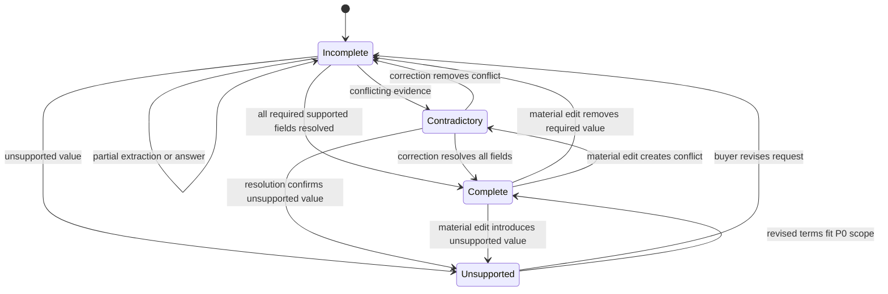
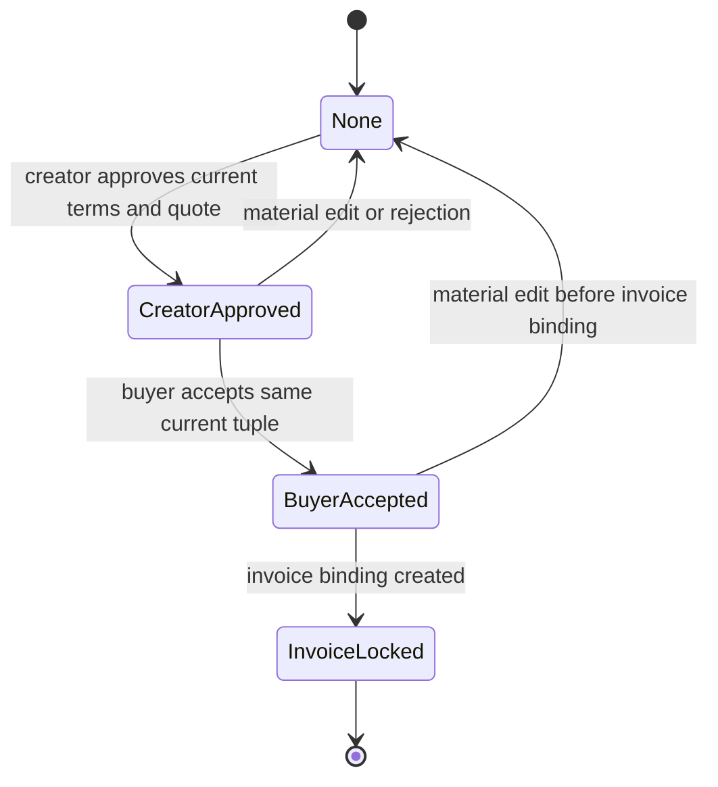
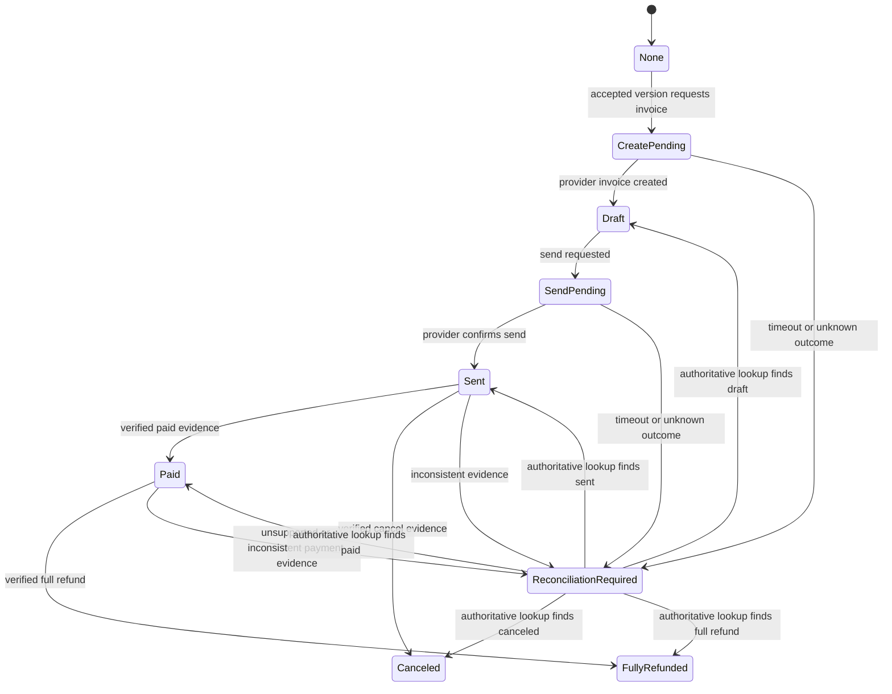
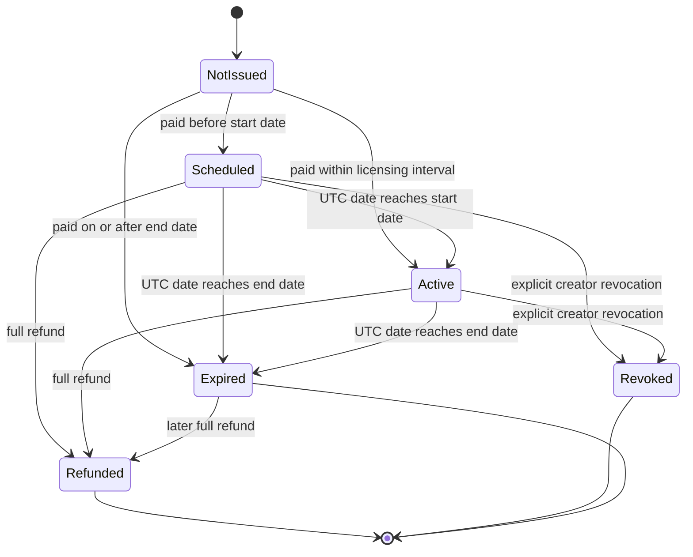

# RightsReceipt Domain Model, State Machines, and Invariants

**Status:** Accepted domain baseline  
**Owning turn:** Turn 005  
**Last reviewed:** October 25, 2026 HST  
**Related architecture:** [`SYSTEM_ARCHITECTURE.md`](SYSTEM_ARCHITECTURE.md)  
**Related product records:** [`../product/MVP_SCOPE.md`](../product/MVP_SCOPE.md), [`../product/ACCEPTANCE_MATRIX.md`](../product/ACCEPTANCE_MATRIX.md)

## 1. Purpose

This document fixes the database-independent domain model that will drive TypeScript types, persistence schema, application commands, state-transition tests, audit records, and receipt generation.

It defines:

- entities and aggregate boundaries;
- identifier, time, money, and version conventions;
- canonical rights terms and field provenance;
- quote, approval, acceptance, invoice, permission, verification, and receipt lifecycles;
- stale-version and idempotency rules;
- audit event taxonomy;
- receipt revision triggers;
- domain invariants and forbidden transitions;
- a persistence blueprint for Turn 008.

This is a design contract, not an implementation claim. No executable domain package, database schema, migration, or automated test exists as of Turn 005.

## 2. Precedence

When records conflict, use this order:

1. `PROJECT_STATUS.md` for current execution state.
2. `MVP_SCOPE.md` for the product boundary.
3. `ACCEPTANCE_MATRIX.md` for P0 verification ownership.
4. This document for domain semantics.
5. `SYSTEM_ARCHITECTURE.md` for runtime and package boundaries.
6. Accepted ADRs for durable tradeoffs.
7. `DEVELOPMENT_PLAN.md` for the broader backlog.

A product-scope change cannot be introduced only through a domain type. Material scope changes still require the change-control procedure in `MVP_SCOPE.md`.

## 3. Domain design rules

1. AI observations are proposals, never authority.
2. Money, supported-scope checks, and lifecycle transitions are deterministic.
3. Original buyer text, accepted evidence, audit events, and receipt revisions are append-only.
4. Material terms are immutable versions. They are never edited in place.
5. Quotes, creator approvals, buyer acceptances, and invoices bind to exact immutable versions.
6. Stale commands fail with a conflict and create no side effect.
7. PayPal is authoritative for Sandbox invoice payment state.
8. Permission state is derived only from accepted terms, human consent, verified payment evidence, and time.
9. A payment state and a permission-effective state are separate concepts.
10. A public verification record may exist before a paid rights receipt exists.
11. Every consequential mutation writes an audit event in the same atomic persistence boundary.
12. Fake-adapter evidence is always labeled simulated and cannot be represented as PayPal Sandbox evidence.
13. Terminal outcomes are not silently reopened. A materially new deal requires a new licensing case.
14. Public verification exposes less data than creator and buyer views.
15. Receipt hashing proves consistency of the stored canonical payload, not ownership, identity, enforceability, or buyer compliance.

## 4. Identifier conventions

### 4.1 Internal entity identifiers

Internal entity identifiers use canonical lowercase UUID version 4 strings.

Examples:

- `workspace_id`
- `asset_id`
- `case_id`
- `terms_version_id`
- `quote_id`
- `invoice_binding_id`
- `permission_id`
- `receipt_revision_id`
- `audit_event_id`

Rules:

- Identifiers are generated through an injected identifier port.
- Identifiers are never reassigned or reused after reset.
- Database row numbers are not domain identifiers.
- Internal UUIDs are not accepted as public capability credentials.

### 4.2 Public verification identifiers

A public verification identifier is at least 128 bits of cryptographically random data encoded as unpadded base64url.

Rules:

- It is opaque and non-sequential.
- It is not a buyer or creator capability.
- It may be stored in clear form because it identifies a privacy-minimized public record, not a privileged action.
- Rate limiting and response minimization remain required.

### 4.3 Buyer capability tokens

A buyer capability token is at least 256 bits of cryptographically random data encoded as unpadded base64url.

Rules:

- The plaintext token is returned only when the buyer route is created.
- Only a SHA-256 digest of the token is stored.
- The capability is scoped to one licensing case and an explicit action set.
- Rotation creates a new capability and revokes the prior digest.
- Tokens never appear in logs, analytics, audit payloads, or public verification output.

### 4.4 External identifiers

PayPal invoice, event, transmission, and request identifiers are stored as validated external strings with provider and environment metadata. They are not converted into internal UUIDs.

## 5. Time and date conventions

### 5.1 Instants

- Audit, consent, payment, and persistence timestamps use UTC instants.
- Canonical serialization uses ISO 8601 UTC with a trailing `Z`.
- Domain commands obtain time only through an injected clock port.
- Tests use a fake clock.

### 5.2 Licensing dates

Licensing dates are date-only ISO `YYYY-MM-DD` values evaluated against the UTC calendar.

The licensing interval is half-open:

```text
[start_date, end_date_exclusive)
```

Where:

```text
end_date_exclusive = start_date + duration_days
last_permitted_date = end_date_exclusive - 1 day
```

Rules:

- `start_date` is inclusive.
- `end_date_exclusive` is not licensed.
- `duration_days` is an integer from 1 through 365.
- Automated status refresh uses the UTC calendar date from the clock port.
- The UI must state that canonical date evaluation uses UTC.

### 5.3 Paid before the start date

A verified paid invoice can issue a permission before its licensing interval begins. In that case, the permission state is `scheduled`, not `active`.

This prevents the application from representing future-dated rights as currently usable. The minimum verification statuses listed in the acceptance matrix are not treated as exhaustive. `scheduled` is a required truthful state whenever payment is confirmed before the start date.

### 5.4 Paid after the interval ends

If verified paid evidence first arrives on or after `end_date_exclusive`, the permission is issued directly as `expired`. It is never briefly represented as active.

## 6. Money conventions

```text
Money = {
  currency: "USD",
  amount_cents: integer
}
```

Rules:

- Currency is fixed to `USD` in P0.
- Amounts are safe non-negative integers.
- Floating-point storage and arithmetic are prohibited.
- Quote total equals the exact sum of line-item amounts.
- Buyer input and AI output never provide a monetary amount to the pricing engine.
- The canonical demo quote is exactly 42,500 cents.

## 7. Aggregate map



The aggregates are intentionally small enough for clear invariants but connected by application commands and atomic D1 batches where a transition spans more than one table.

## 8. Entity catalog

### 8.1 CreatorWorkspace

Represents the seeded creator operating context.

Required fields:

- `workspace_id`
- `display_name`
- `mode`: `demo`
- `default_pricing_policy_id`
- `default_pricing_policy_version`
- `created_at`
- `updated_at`
- `row_version`

P0 contains one seeded workspace. This entity does not imply public accounts, teams, or multi-tenant billing.

### 8.2 Asset

Represents one creator-controlled metadata record.

Required fields:

- `asset_id`
- `workspace_id`
- `title`
- `asset_type`: `photograph` or `illustration`
- `creator_display_name`
- `provenance_note`
- `fingerprint_algorithm`
- `fingerprint_value`
- `preview_reference`
- `availability`: `active` or `archived`
- `created_at`
- `updated_at`
- `row_version`

Invariants:

- A licensing case binds to exactly one asset.
- The asset cannot change after request submission.
- An archived asset cannot receive a new request.
- A fingerprint identifies one file representation and does not prove ownership.

### 8.3 LicensingCase

The coordinating aggregate for one proposed direct license.

Required fields:

- `case_id`
- `workspace_id`
- `asset_id`
- `request_submission_id`
- `case_outcome`: `open`, `rejected`, or `canceled`
- `latest_extraction_attempt_id`, nullable
- `latest_terms_version_id`, nullable
- `latest_quote_id`, nullable
- `latest_creator_decision_id`, nullable
- `latest_buyer_acceptance_id`, nullable
- `invoice_binding_id`, nullable
- `permission_id`, nullable
- `verification_record_id`
- `created_at`
- `updated_at`
- `row_version`

`case_outcome` stores only the explicit case-closing decision. The user-facing workflow stage is derived from current versions and related aggregate states.

### 8.4 RequestSubmission

Immutable record of the buyer's original submission.

Required fields:

- `request_submission_id`
- `case_id`
- `buyer_name`
- `buyer_organization`
- `buyer_email_original`
- `buyer_email_normalized`
- `intended_use_text_original`
- `consent_copy_version`
- `consent_accepted_at`
- `submitted_at`

Rules:

- Original text is preserved byte-for-byte as received after transport decoding.
- Normalized text, when needed, is stored separately.
- The original submission is never overwritten by clarification answers.

### 8.5 BuyerCapability

Authorizes a constrained buyer action set.

Required fields:

- `buyer_capability_id`
- `case_id`
- `token_digest`
- `allowed_actions`
- `issued_at`
- `expires_at`, nullable
- `revoked_at`, nullable
- `rotation_number`

The capability is not a user account and cannot access other cases.

### 8.6 ExtractionAttempt

Immutable result of one extraction run.

Required fields:

- `extraction_attempt_id`
- `case_id`
- `attempt_number`
- `input_document_set_hash`
- `extractor_version`
- `model_id`
- `model_version`
- `artifact_hash`
- `started_at`
- `completed_at`
- `outcome`: `completed`, `partial`, or `failed`
- `failure_code`, nullable

An extraction attempt does not change canonical terms by itself. It creates observations that a later command turns into a terms version.

### 8.7 FieldObservation

One proposed field value or unresolved result from extraction or clarification.

Required fields:

- `field_observation_id`
- `extraction_attempt_id` or `clarification_answer_id`
- `field_name`
- `resolution_state`: `resolved`, `unresolved`, `contradictory`, or `unsupported`
- `proposed_value`, nullable
- `source_kind`: `deterministic_extractor`, `local_model`, `buyer_clarification`, or `creator_correction`
- `confidence_bps`, nullable
- `resolver_version`
- `evidence_document_id`, nullable
- `evidence_start_utf16`, nullable
- `evidence_end_utf16`, nullable
- `evidence_text`, nullable

Rules:

- Model confidence is stored as integer basis points from 0 through 10,000.
- Human-entered values use `confidence_bps = null`.
- Evidence offsets use UTF-16 code units so browser highlighting is deterministic.
- The stored evidence text must match the referenced source span.

### 8.8 ClarificationRound

Groups questions and buyer answers against a specific terms version.

Required fields:

- `clarification_round_id`
- `case_id`
- `based_on_terms_version_id`
- `round_number`
- `question_set_version`
- `opened_at`
- `answered_at`, nullable
- `closed_reason`, nullable

Each question targets one or more unresolved or contradictory required fields. A stale round cannot update a newer terms version.

### 8.9 TermsVersion

Immutable canonical snapshot of all material rights fields.

Required fields:

- `terms_version_id`
- `case_id`
- `version_number`
- `schema_version`
- `resolution_status`: `incomplete`, `contradictory`, `unsupported`, or `complete`
- canonical rights fields from Section 9
- `source_summary`
- `created_by_actor_type`
- `created_by_actor_id`, nullable
- `created_at`
- `terms_hash`
- `supersedes_terms_version_id`, nullable

Only `complete` terms may be priced.

### 8.10 PricingPolicyVersion

Immutable creator pricing policy.

Required fields:

- `pricing_policy_id`
- `version_number`
- `schema_version`
- supported value boundaries
- line-item rules in integer cents
- `policy_hash`
- `effective_from`
- `retired_at`, nullable
- `created_at`

Historical quotes always retain their exact policy version.

### 8.11 QuoteVersion

Immutable deterministic quote.

Required fields:

- `quote_id`
- `case_id`
- `quote_version_number`
- `terms_version_id`
- `pricing_policy_id`
- `pricing_policy_version`
- `currency`: `USD`
- `total_cents`
- `quote_hash`
- `status`: `current` or `superseded`
- `created_at`

Quote lines are immutable child records containing stable line code, description, amount in cents, and display order.

### 8.12 CreatorDecision

Immutable creator action.

Required fields:

- `creator_decision_id`
- `case_id`
- `decision`: `approved`, `rejected`, or `clarification_requested`
- `terms_version_id`
- `quote_id`, nullable when not approved
- `reason_code`, nullable
- `reason_text`, nullable
- `actor_id`
- `decided_at`

An approval is effective only while its terms and quote remain current and no material edit has occurred.

### 8.13 BuyerAcceptance

Immutable acceptance of the exact creator-approved package.

Required fields:

- `buyer_acceptance_id`
- `case_id`
- `terms_version_id`
- `quote_id`
- `creator_decision_id`
- `acceptance_copy_version`
- `buyer_capability_id`
- `accepted_at`
- `acceptance_hash`

Acceptance is idempotent for the same case, terms version, quote, creator decision, and copy version.

### 8.14 PaymentOperation

Tracks one external operation intent.

Required fields:

- `payment_operation_id`
- `case_id`
- `operation_kind`: `create_invoice`, `send_invoice`, `retrieve_status`, or `reconcile`
- `operation_key`
- `payment_mode`: `simulated` or `paypal_sandbox`
- `status`: `pending`, `succeeded`, `failed_retryable`, `failed_terminal`, or `unknown_outcome`
- `attempt_count`
- `last_error_code`, nullable
- `created_at`
- `updated_at`

`operation_key` is unique and deterministic for the operation kind and accepted version tuple.

### 8.15 InvoiceBinding

Binds one accepted package to one provider invoice.

Required fields:

- `invoice_binding_id`
- `case_id`
- `buyer_acceptance_id`
- `terms_version_id`
- `quote_id`
- `payment_mode`
- `provider`: `fake_paypal` or `paypal`
- `environment`: `simulated` or `sandbox`
- `provider_invoice_id`, nullable until known
- `provider_invoice_number`, nullable
- `invoice_state`
- `state_observed_at`
- `state_source`
- `created_at`
- `updated_at`
- `row_version`

A case has at most one invoice binding in P0. Material changes after invoice creation require a new licensing case.

### 8.16 WebhookInboxEvent

Durable accepted webhook metadata.

Required fields:

- `webhook_event_id`
- `provider`
- `environment`
- `provider_event_id`
- `provider_transmission_id`, nullable
- `event_type`
- `invoice_reference`, nullable
- `authenticity_status`: `verified`
- `payload_digest`
- redacted normalized metadata
- `processing_status`: `pending`, `processed`, `ignored_duplicate`, `ignored_stale`, or `failed_retryable`
- `received_at`
- `processed_at`, nullable
- `correlation_id`

Unverified webhook bodies are rejected before this domain entity is created. Security telemetry may record a safe rejection count outside the business audit stream.

### 8.17 PaymentEvidence

Immutable normalized evidence used by the lifecycle engine.

Required fields:

- `payment_evidence_id`
- `invoice_binding_id`
- `evidence_kind`: `verified_webhook`, `reconciliation_snapshot`, or `simulated_fixture`
- `trust_level`: `paypal_sandbox_verified` or `simulated`
- `provider_state`
- `effective_at`
- `source_reference`
- `evidence_digest`
- `recorded_at`

A payment claim from buyer text, browser input, AI output, or an unverified webhook can never create this entity.

### 8.18 Permission

Current deterministic permission projection.

Required fields:

- `permission_id`
- `case_id`
- `invoice_binding_id`
- `terms_version_id`
- `quote_id`
- `state`: `not_issued`, `scheduled`, `active`, `expired`, `refunded`, or `revoked`
- `start_date`
- `end_date_exclusive`
- `last_state_change_at`
- `state_reason_code`
- `issuing_payment_evidence_id`, nullable
- `latest_payment_evidence_id`, nullable
- `row_version`

`not_issued` may be represented by absence of a persisted permission row until invoice binding. The implementation must choose one representation consistently in Turn 008.

### 8.19 VerificationRecord

Privacy-minimized public status anchor.

Required fields:

- `verification_record_id`
- `case_id`
- `public_verification_id`
- `current_status`
- `current_receipt_revision_id`, nullable
- `created_at`
- `updated_at`
- `row_version`

The record may exist before a paid receipt exists. This allows a canceled invoice to be verified as `canceled` without pretending that a rights receipt was issued.

### 8.20 ReceiptRevision

Immutable canonical rights receipt revision.

Required fields:

- `receipt_revision_id`
- `verification_record_id`
- `revision_number`
- `schema_version`
- `previous_revision_hash`, nullable
- `canonical_payload_json`
- `payload_hash_algorithm`: `sha256`
- `payload_hash_hex`
- `permission_state`
- `created_at`
- `trigger_event_id`

A receipt revision is created only after permission issuance or a material permission-state change. It is never edited or deleted in normal operation.

### 8.21 AuditEvent

Append-only record of a consequential fact.

Required fields:

- `audit_event_id`
- `case_id`
- `aggregate_type`
- `aggregate_id`
- `aggregate_sequence`
- `event_type`
- `event_schema_version`
- `actor_type`
- `actor_id`, nullable
- `occurred_at`
- `recorded_at`
- `correlation_id`
- `causation_id`, nullable
- safe structured payload

Audit events are evidence, not the sole source used to reconstruct current state. P0 is not an event-sourced system.

## 9. Canonical rights terms

```text
RightsTermsV1 = {
  use_purpose: "commercial",
  channels: non-empty sorted unique subset of ["facebook_paid", "instagram_paid"],
  paid_advertising: true,
  territories: non-empty sorted unique subset of ["CA", "US"],
  start_date: ISO date,
  duration_days: integer 1 through 365,
  end_date_exclusive: derived ISO date,
  max_impressions: integer 1 through 500000,
  exclusivity: "non_exclusive",
  modification_scope: "none" or "crop_only",
  attribution: "required" or "not_required",
  sublicensing: "prohibited",
  ai_use: "prohibited"
}
```

Canonical ordering rules:

- Channels sort lexicographically after deduplication.
- Territories sort lexicographically after deduplication.
- Derived dates are recalculated and validated rather than trusted from input.
- Unsupported values remain observations and never enter a `complete` terms payload.
- The terms hash covers schema version and every canonical material field.

## 10. Material and non-material changes

### Material changes

Any change to one of these creates a new terms version:

- asset binding;
- any canonical rights field;
- buyer organization identity used on the invoice;
- start or end date semantics;
- any restriction represented in the canonical payload.

A material change supersedes the current quote and invalidates any effective creator approval and buyer acceptance.

### Non-material changes

These do not create a new terms version:

- display formatting;
- spelling or capitalization changes that do not alter canonical meaning;
- UI labels;
- private operational notes;
- correction of a non-canonical typo in display-only text.

Materiality is determined by canonical payload comparison, not by a UI flag.

## 11. Version and staleness model

### 11.1 Version numbers

- Terms, quotes, policies, extraction attempts, clarification rounds, receipt revisions, and aggregate sequences start at 1.
- Version numbers are monotonically increasing within their parent.
- Gaps are permitted after failed transactions, but reuse is prohibited.

### 11.2 Expected-version commands

Every consequential human command includes:

- `case_id`;
- `expected_case_row_version`;
- the exact target terms and quote identifiers where applicable;
- a client-generated idempotency key where repeated submission is possible.

A mismatch returns `stale_version` and writes no business-state change.

### 11.3 Invalidating prior consent

Creating a materially different terms version causes:

- the prior quote to become `superseded`;
- prior creator approval to remain historical but no longer effective;
- prior buyer acceptance to remain historical but no longer effective;
- invoice eligibility to return to false.

Once an invoice binding exists, P0 forbids material editing in that case. The operator must cancel the unpaid case when allowed and create a new licensing case.

### 11.4 Idempotent replay

The same idempotency key with the same command fingerprint returns the prior result. Reusing the key with a different command fingerprint returns `idempotency_conflict`.

## 12. Derived user-facing case stage

`case_stage` is a derived projection. It is not directly writable.

The derivation uses this precedence, first match wins:

1. `rejected` when case outcome is rejected.
2. `revoked` when permission state is revoked.
3. `refunded` when permission state is refunded or invoice is fully refunded after payment.
4. `expired` when permission state is expired.
5. `active` when permission state is active.
6. `scheduled` when permission state is scheduled.
7. `canceled` when case outcome or unpaid invoice state is canceled.
8. `payment_review_required` when provider evidence is inconsistent or unsupported.
9. `invoice_sent` when invoice state is sent.
10. `invoice_pending` when create or send operation is pending or outcome is unknown.
11. `buyer_accepted` when a current buyer acceptance exists.
12. `creator_approved` when a current creator approval exists.
13. `quoted` when a current quote exists.
14. `unsupported` when current terms are unsupported.
15. `clarification_required` when current terms are incomplete or contradictory.
16. `ready_for_quote` when current terms are complete.
17. `submitted` otherwise.

A cached stage column, if used for queries, must be updated atomically and test equal to the derivation.

## 13. Terms resolution state machine



Only `Complete` can enter pricing.

## 14. Consent state machine

Consent state is derived for the latest terms and quote tuple.



Rules:

- Creator approval requires a current complete terms version and current quote.
- Buyer acceptance requires the effective creator approval.
- Invoice creation requires effective buyer acceptance.
- No consent is inferred from request text, email, payment, or model output.
- After invoice binding, material edits are forbidden in P0.

## 15. Invoice lifecycle

Canonical local invoice states:

- `none`
- `create_pending`
- `draft`
- `send_pending`
- `sent`
- `paid`
- `canceled`
- `fully_refunded`
- `reconciliation_required`



Rules:

- Provider events never regress `paid` to `sent`.
- A cancel event observed after paid is stale or inconsistent and requires reconciliation.
- A refund cannot be applied without evidence that the invoice was paid.
- Partial refund is outside automatic P0 handling. It enters `reconciliation_required` and the public view must not claim a clean active state until resolved.
- `simulated` and `paypal_sandbox` modes cannot mix within one invoice binding.

## 16. Permission lifecycle



Rules:

- `NotIssued` is never publicly described as permission.
- Only verified paid evidence or an explicitly simulated fixture can issue a permission.
- Simulated permissions are labeled simulated in every view and export.
- Creator approval, buyer acceptance, invoice creation, invoice sending, and browser clicks do not issue permission.
- Full refund makes the permission non-active immediately.
- Revocation is a creator action and does not claim that PayPal refunded money.
- Expiration is deterministic from the UTC calendar and `end_date_exclusive`.
- Terminal states cannot return to active in the same licensing case.

## 17. Verification lifecycle

The public verification record is not identical to a paid receipt.

Possible P0 statuses:

- `pending_payment`
- `canceled`
- `scheduled`
- `active`
- `expired`
- `refunded`
- `revoked`
- `review_required`
- `invalid`
- `not_found`, represented as a response outcome rather than a stored record

Rules:

- A verification record is reserved before external invoice creation so the case has one stable public reference.
- `pending_payment` and `canceled` may have no receipt revision or hash.
- `scheduled`, `active`, `expired`, `refunded`, and `revoked` require a receipt revision.
- `review_required` hides any claim that the permission is active while payment evidence is inconsistent.
- `invalid` means an expected receipt revision failed integrity validation or internal references do not reconcile.
- Public responses expose no buyer email, capability token, raw webhook data, private notes, or operation internals.

## 18. Application transition table

| Command or fact | Required preconditions | Atomic results | Rejection examples |
| --- | --- | --- | --- |
| Submit request | Active asset, valid buyer fields, consent acknowledged | Create case, request, capability digest, verification record, audit event | Unknown asset, archived asset, invalid input |
| Record extraction | Open case, valid artifact metadata | Create extraction attempt, observations, audit event | Corrupt artifact, stale input set |
| Create terms version | Open case, valid field set | Append terms version, update latest pointer, invalidate stale quote and consent, audit | Invalid schema, stale case version |
| Calculate quote | Current complete supported terms, active policy | Append quote and lines, mark prior quote superseded, audit | Unresolved, contradictory, unsupported, out of range |
| Creator approve | Current quote and terms, open case | Append approval, audit | Stale quote, rejected case |
| Creator reject | Open case, no paid permission | Append decision, set outcome rejected, audit | Already invoiced, terminal case |
| Buyer accept | Current effective creator approval | Append acceptance, audit | Stale terms, stale quote, wrong capability |
| Request invoice creation | Current acceptance, no invoice binding | Create operation and invoice binding in `create_pending`, verification `pending_payment`, audit | Missing acceptance, duplicate binding, simulated/sandbox mismatch |
| Bind created invoice | Matching pending operation | Store provider ID, set draft, complete operation, audit | Provider payload mismatch, duplicate provider ID |
| Request invoice send | Draft invoice | Create send operation, set send pending, audit | Already sent, unknown invoice |
| Confirm sent | Matching send operation or reconciliation | Set sent, complete operation, audit | Stale provider response |
| Accept webhook | Authenticity already verified, unique event ID | Append inbox event pending, audit safe metadata | Duplicate accepted ID, missing stable ID |
| Apply payment evidence | Accepted event or reconciliation snapshot | Append evidence, transition invoice, permission, verification, receipt, audit as required | Unverified source, illegal regression |
| Reconcile invoice | Existing binding, authorized operator or recovery path | Record operation, authoritative lookup result, normalized evidence, legal transitions, audit | Production endpoint, mismatched invoice |
| Refresh temporal state | Issued permission, fake or real clock | Scheduled to active or scheduled/active to expired, receipt revision, audit | Clock before required boundary, terminal state |
| Revoke permission | Scheduled or active, creator authority | Set revoked, receipt revision, verification update, audit | Not issued, refunded, expired, stale version |
| Verify receipt | Opaque public ID | Validate chain and return minimized response | Guessable internal ID, hash mismatch |

## 19. Audit event taxonomy

### Request and terms

- `request.submitted`
- `extraction.started`
- `extraction.completed`
- `extraction.failed`
- `clarification.opened`
- `clarification.answered`
- `terms.version_created`
- `terms.marked_unsupported`
- `terms.material_change_detected`

### Pricing and consent

- `quote.created`
- `quote.superseded`
- `creator.approved`
- `creator.rejected`
- `creator.clarification_requested`
- `buyer.accepted`
- `consent.invalidated`

### PayPal and payment

- `invoice.create_requested`
- `invoice.created`
- `invoice.send_requested`
- `invoice.sent`
- `invoice.operation_failed`
- `invoice.reconciliation_started`
- `invoice.reconciled`
- `webhook.accepted`
- `webhook.processed`
- `webhook.duplicate_ignored`
- `webhook.stale_ignored`
- `payment.paid_confirmed`
- `invoice.canceled_confirmed`
- `payment.full_refund_confirmed`
- `payment.review_required`

### Permission and receipts

- `permission.scheduled`
- `permission.activated`
- `permission.expired`
- `permission.revoked`
- `permission.refunded`
- `verification.status_changed`
- `receipt.revision_issued`
- `receipt.integrity_failed`

### Operations

- `demo.reset_completed`
- `capability.rotated`
- `capability.revoked`

Audit payloads contain stable identifiers and safe outcome data, not secrets or full sensitive external payloads.

## 20. Receipt canonical payload

The canonical receipt payload uses this logical field set:

```text
ReceiptPayloadV1 = {
  schema_version,
  receipt_chain_id,
  revision_number,
  previous_revision_hash,
  verification_public_id,
  case_id,
  asset: {
    asset_id,
    title,
    asset_type,
    fingerprint_algorithm,
    fingerprint_value
  },
  creator: {
    display_name
  },
  buyer: {
    organization_display_name
  },
  terms: RightsTermsV1,
  period: {
    start_date,
    end_date_exclusive,
    last_permitted_date
  },
  quote: {
    quote_id,
    amount_cents,
    currency,
    pricing_policy_id,
    pricing_policy_version
  },
  consent: {
    terms_version_id,
    creator_approval_at,
    buyer_acceptance_at
  },
  ai_provenance: {
    extraction_attempt_id,
    extractor_version,
    model_id,
    model_version,
    artifact_hash
  },
  payment: {
    provider,
    environment,
    safe_invoice_reference,
    payment_status,
    confirmed_at
  },
  permission: {
    state,
    state_effective_at,
    state_reason_code
  },
  created_at
}
```

Rules:

- Canonical JSON follows RFC 8785.
- Hash output is lowercase SHA-256 hexadecimal.
- `previous_revision_hash` is null only for revision 1.
- The public verification response is a filtered projection and is not the canonical payload.
- The creator and buyer JSON export may include internal identifiers needed for audit, but never secrets.

## 21. Receipt revision triggers

Create a new immutable receipt revision when:

1. verified paid evidence first issues permission as scheduled, active, or expired;
2. scheduled permission becomes active;
3. scheduled or active permission becomes expired;
4. scheduled, active, or expired permission becomes refunded;
5. scheduled or active permission becomes revoked;
6. a prior revision is superseded by a required canonical schema migration, only through an explicit future ADR.

Do not create a new receipt revision for:

- display formatting changes;
- UI copy changes;
- non-material operational notes;
- repeated identical webhook events;
- a status lookup that confirms the already stored state;
- audit-only events with no canonical payload change.

A hash mismatch never rewrites history. It marks verification invalid, appends a security audit event, and requires operator investigation.

## 22. Domain invariants

### Identity and ownership boundaries

- `RR-DOM-001`: Every case belongs to exactly one workspace and one asset.
- `RR-DOM-002`: The asset binding cannot change after request submission.
- `RR-DOM-003`: Internal IDs are never used as privileged capability tokens.
- `RR-DOM-004`: Buyer capabilities authorize only one case and explicit actions.

### Original evidence

- `RR-DOM-005`: Original intended-use text is immutable.
- `RR-DOM-006`: Evidence offsets must resolve to the stored evidence text.
- `RR-DOM-007`: Human corrections are labeled human-entered and have no model confidence.
- `RR-DOM-008`: Extraction attempts and observations are append-only.

### Terms and scope

- `RR-DOM-009`: A complete terms version contains every required field.
- `RR-DOM-010`: A complete terms version contains only supported P0 values.
- `RR-DOM-011`: Derived end date must equal start date plus duration days.
- `RR-DOM-012`: Material terms are immutable after version creation.
- `RR-DOM-013`: Material changes create a new monotonically numbered version.

### Pricing

- `RR-DOM-014`: Only complete supported terms can be priced.
- `RR-DOM-015`: A quote binds to exactly one terms version and one policy version.
- `RR-DOM-016`: Quote total equals the exact sum of integer-cent line items.
- `RR-DOM-017`: Identical terms and policy versions produce identical quote content.
- `RR-DOM-018`: The Harbor After Rain regression input produces 42,500 cents.

### Consent

- `RR-DOM-019`: Creator approval binds to the current terms and quote.
- `RR-DOM-020`: Buyer acceptance binds to the same effective creator approval, terms, and quote.
- `RR-DOM-021`: A material edit invalidates prior effective consent before invoice binding.
- `RR-DOM-022`: Consent cannot be inferred from free text, payment, or AI output.

### Invoice and payment

- `RR-DOM-023`: Invoice creation requires current buyer acceptance.
- `RR-DOM-024`: One case has at most one invoice binding in P0.
- `RR-DOM-025`: Payment mode is fixed for the invoice binding.
- `RR-DOM-026`: Sandbox and simulated evidence cannot mix.
- `RR-DOM-027`: External operation keys are unique for their command fingerprint.
- `RR-DOM-028`: Provider event identity is deduplicated.
- `RR-DOM-029`: Business state changes only from verified webhook evidence, reconciliation, or labeled simulated fixtures.
- `RR-DOM-030`: Out-of-order evidence cannot regress paid or refunded state.

### Permission

- `RR-DOM-031`: Permission is never issued before verified paid evidence.
- `RR-DOM-032`: Paid before the start date yields scheduled, not active.
- `RR-DOM-033`: Paid within the interval yields active.
- `RR-DOM-034`: Paid after the interval yields expired.
- `RR-DOM-035`: Full refund yields a non-active refunded state.
- `RR-DOM-036`: Revocation and refund remain distinct facts.
- `RR-DOM-037`: Terminal permission states cannot become active in the same case.

### Receipts and verification

- `RR-DOM-038`: Receipt revisions are immutable and sequential.
- `RR-DOM-039`: Every revision after the first references the prior revision hash.
- `RR-DOM-040`: Any material canonical payload change changes the hash.
- `RR-DOM-041`: Display formatting does not affect the canonical hash.
- `RR-DOM-042`: A canceled unpaid case has no rights receipt revision.
- `RR-DOM-043`: Public verification reveals no buyer email, secret, capability, raw webhook body, or private note.
- `RR-DOM-044`: A hash mismatch produces invalid verification and never silent repair.

### Atomicity and audit

- `RR-DOM-045`: A consequential state transition and its audit event commit atomically.
- `RR-DOM-046`: Aggregate sequence numbers are unique and increasing.
- `RR-DOM-047`: Failed stale commands create no business-state mutation.
- `RR-DOM-048`: Replayed idempotent commands do not duplicate side effects.
- `RR-DOM-049`: Audit events are append-only.
- `RR-DOM-050`: Current projections must agree with deterministic derivation from current authoritative records.

## 23. Forbidden transitions

The domain must reject all of the following:

- quote incomplete, contradictory, unsupported, or out-of-range terms;
- approve a stale or superseded quote;
- accept terms without effective creator approval;
- create an invoice without effective buyer acceptance;
- create a second invoice binding for the same case;
- materially edit terms after invoice binding;
- issue permission from invoice creation, invoice sending, browser input, AI output, or unverified webhook data;
- treat a simulated fixture as PayPal Sandbox evidence;
- cancel an already paid permission as though cancellation were a refund;
- apply a refund before paid evidence exists;
- reactivate a refunded, revoked, or expired permission in the same case;
- overwrite a receipt revision;
- rewrite original request text or audit history;
- expose internal IDs as buyer capabilities;
- accept production PayPal endpoints or evidence in the hackathon release;
- mark payment or permission cleanly active while provider state requires reconciliation.

## 24. Persistence blueprint

Turn 008 should create relational structures corresponding to these records:

- `creator_workspaces`
- `assets`
- `licensing_cases`
- `request_submissions`
- `buyer_capabilities`
- `extraction_attempts`
- `field_observations`
- `clarification_rounds`
- `clarification_questions`
- `clarification_answers`
- `terms_versions`
- `pricing_policy_versions`
- `quotes`
- `quote_lines`
- `creator_decisions`
- `buyer_acceptances`
- `payment_operations`
- `invoice_bindings`
- `webhook_inbox_events`
- `payment_evidence`
- `permissions`
- `verification_records`
- `receipt_revisions`
- `audit_events`
- `demo_reset_epochs`

Required database constraints include:

- unique `(case_id, version_number)` for terms versions;
- unique `(case_id, quote_version_number)` for quotes;
- unique `(pricing_policy_id, version_number)` for policy versions;
- unique `operation_key` for payment operations;
- unique `(provider, environment, provider_event_id)` for webhook events;
- unique provider invoice ID within provider and environment;
- unique public verification ID;
- unique `(verification_record_id, revision_number)` for receipt revisions;
- unique `(case_id, aggregate_type, aggregate_id, aggregate_sequence)` for audit ordering;
- foreign keys for every domain reference;
- check constraints for integer ranges and supported enumerations where D1 permits them.

Schema implementation may normalize canonical term fields into columns or validated JSON, but the resulting repository must enforce the same domain contract and support deterministic queries and tests.

## 25. Test blueprint

Turn 007 and later implementation turns should derive tests from this document.

### Pure domain tests

- value object construction and invalid boundaries;
- all terms resolution transitions;
- quote determinism and 42,500-cent regression;
- consent invalidation on material change;
- case-stage derivation precedence;
- invoice transition table and illegal regressions;
- permission scheduling, activation, expiration, refund, and revocation with a fake clock;
- receipt revision trigger matrix;
- canonical payload mutation and hash behavior;
- stale-version and idempotency conflicts.

### Property tests

- canonical channel and territory ordering;
- quote line sum equals total;
- equivalent canonical terms hash identically;
- any material term mutation changes the terms hash;
- any material receipt mutation changes the receipt hash;
- duplicate events do not increase side-effect counts;
- valid event permutations converge to the documented final state.

### Integration tests

- atomic state plus audit writes;
- unique provider event and operation constraints;
- one invoice binding per case;
- stored current projections equal domain derivation;
- capability digest lookup and cross-case rejection;
- receipt chain continuity;
- deterministic reset restores seeded IDs and clears stale transaction state.

## 26. Acceptance-matrix relationship

This turn does not pass a P0 requirement because no executable evidence exists yet. It materially defines the implementation contract for:

- `RR-P0-008` through `RR-P0-031`;
- `RR-P0-039` through `RR-P0-059`;
- `RR-P0-062` through `RR-P0-065`.

Future turn receipts should cite both the relevant P0 requirement and the domain invariant or transition being implemented.

## 27. Scope clarifications discovered in Turn 005

Two terminology ambiguities are resolved without expanding the commercial feature set:

1. A paid future-dated permission is `scheduled` until its start date. It is never falsely labeled active.
2. A canceled unpaid invoice may have a public verification status, but it has no rights receipt revision because no permission was issued.

The final demo turn must use a date scenario that truthfully produces the status shown in the video. The fixed narrative fixture may show `scheduled`, or the recording fixture may use an effective date on or before the recording date while preserving all other frozen terms.

## 28. Deferred decisions

Turn 006 still owns:

- exact screen and route journeys;
- visual status presentation;
- accessibility interaction details;
- error and recovery copy.

Turn 007 still owns:

- concrete TypeScript branded types;
- exact package filenames;
- dependency versions;
- executable test harnesses.

Turn 008 still owns:

- exact D1 table definitions;
- checked-in SQL migrations;
- seed and reset implementation;
- repository mappings.

Later PayPal, model, security, and receipt turns may refine adapters and evidence formats but may not violate these invariants without an explicit superseding decision.
