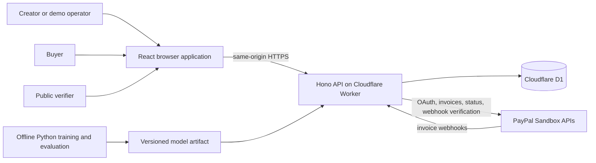
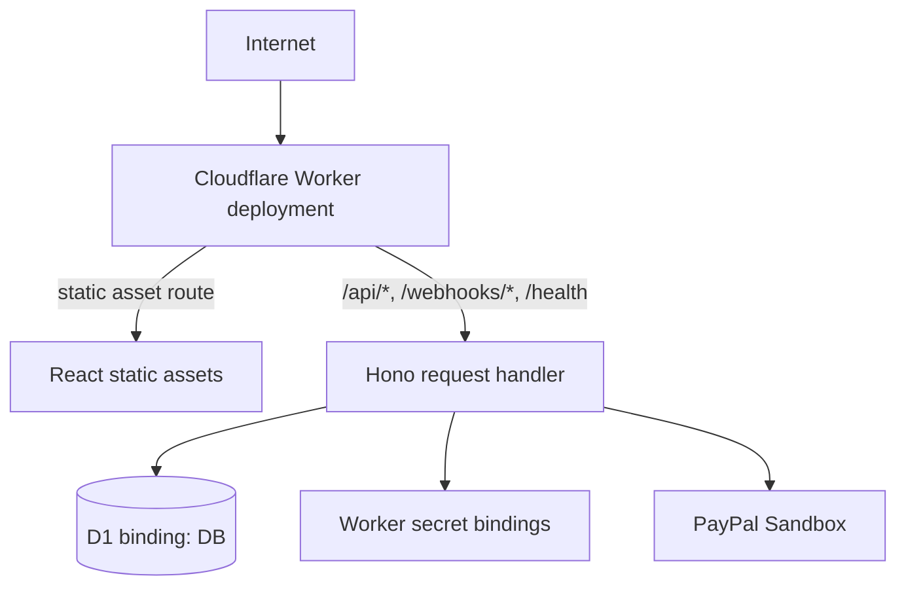
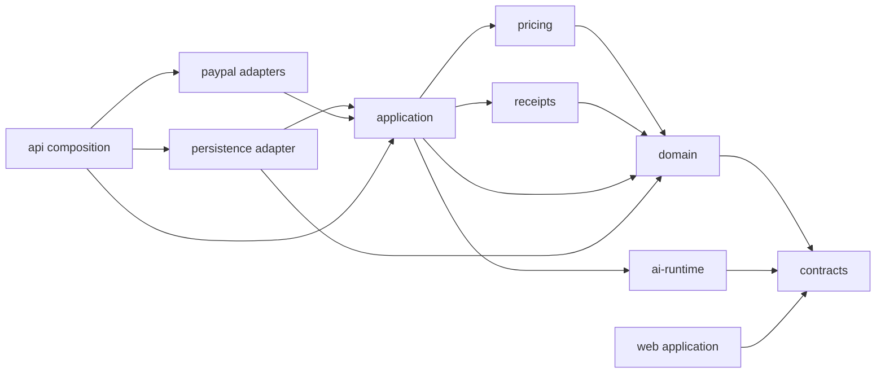
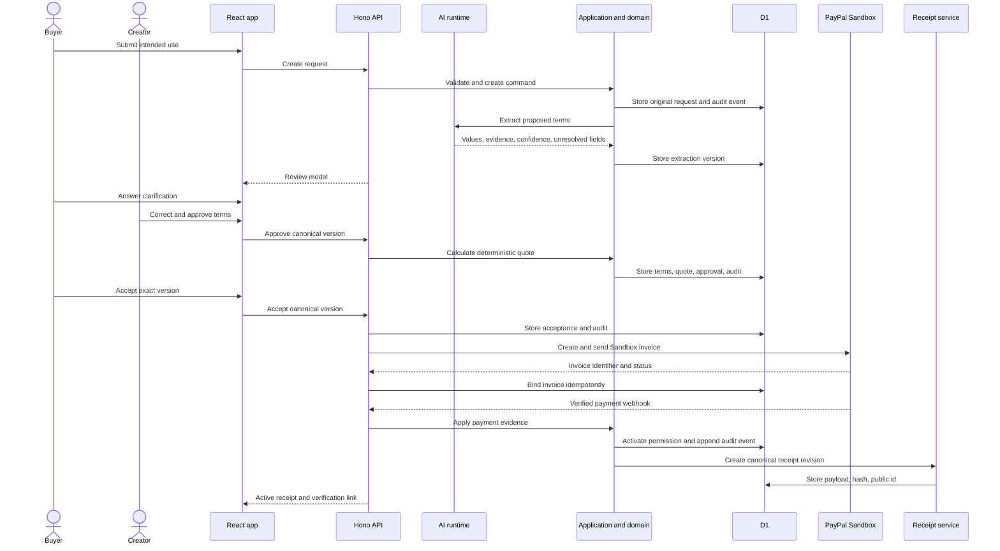

# RightsReceipt System Architecture

**Status:** Accepted architecture baseline  
**Owning turn:** Turn 004  
**Last reviewed:** October 25, 2026 HST  
**Next refinement:** Turn 005 defines the domain model, state machine, and invariants  
**Related product records:** [`../product/PRODUCT_BRIEF.md`](../product/PRODUCT_BRIEF.md), [`../product/MVP_SCOPE.md`](../product/MVP_SCOPE.md), [`../product/ACCEPTANCE_MATRIX.md`](../product/ACCEPTANCE_MATRIX.md)

## 1. Purpose

This document fixes the technical shape of the RightsReceipt hackathon MVP before executable scaffolding begins. It describes the runtime, deployment, package boundaries, persistence strategy, local model boundary, PayPal trust boundary, receipt service, access model, and verification approach.

This is an architecture contract, not an implementation claim. As of Turn 004, no application code, database, model artifact, PayPal integration, deployment, or automated test suite exists.

## 2. Architecture drivers

The architecture must optimize for these constraints in this order:

1. **Truthful end-to-end behavior:** real PayPal Sandbox evidence must be distinguishable from simulated local behavior.
2. **Deterministic authority:** AI cannot set prices, approve terms, confirm payment, or change permission state.
3. **Hackathon reliability:** one complete request-to-receipt path is more important than broad feature coverage.
4. **Local reproducibility:** development and automated tests must work without paid APIs or GitHub Actions.
5. **Small operational surface:** the deployed judge path should use as few independently failing services as practical.
6. **Auditable state:** material actions, versions, payment references, and receipt revisions must be traceable.
7. **Portfolio quality:** the repository should demonstrate clean boundaries, tests, security discipline, and understandable tradeoffs.
8. **Scope discipline:** architecture must satisfy the frozen MVP without adding a marketplace, general contract platform, or autonomous payment agent.

## 3. Accepted stack

| Concern | Accepted direction | Reason |
| --- | --- | --- |
| Repository | pnpm workspace monorepo | One lockfile, explicit internal packages, filtered commands, and low orchestration overhead |
| Primary language | Strict TypeScript | Shared contracts across browser, API, domain, adapters, and inference runtime |
| Browser application | React single-page application with React Router and Vite | Fast implementation, clear client routing, and a strong demo surface |
| API | Hono using Web Standard request and response APIs | Small typed API layer that runs directly on Cloudflare Workers |
| Deployment | One Cloudflare Worker deployment with static assets and API routes on one origin | Avoids CORS and two-service deployment drift while keeping source boundaries clear |
| Build integration | Cloudflare Vite plugin and Wrangler | Local `workerd` behavior, static asset build, Worker bindings, and CLI deployment |
| Persistence | Cloudflare D1 with SQLite semantics, Drizzle ORM inside the persistence adapter, and checked-in SQL migrations | Relational constraints, local D1 support, explicit migrations, and typed repository mapping |
| Runtime validation | Zod schemas in a shared contracts package | One server-side validation source for external and persisted boundary data |
| Local AI | Offline Python training and evaluation, portable versioned JSON artifact, pure TypeScript inference | No paid inference service and no Python process in the deployed Worker |
| Payments | Direct PayPal REST integration through a payment port with fake and Sandbox adapters | Explicit payload control, deterministic local tests, and clear Sandbox-only enforcement |
| Receipt integrity | RFC 8785 JSON Canonicalization Scheme plus SHA-256 through Web Crypto | Stable hash input and portable verification without blockchain or signature claims |
| TypeScript tests | Vitest, including the Cloudflare Workers Vitest integration for Worker and D1 behavior | Fast local tests that exercise the actual Worker runtime model |
| Browser tests | Playwright | Repeatable judge-path and failure-path evidence |
| Model tests | Python test and evaluation commands | Reproducible data generation, training, export, and metric evidence |
| Deployment automation | Local scripts only | The project explicitly does not depend on GitHub Actions |

Exact dependency versions are selected and locked in Turn 007. The architecture requires stable releases compatible with the chosen Cloudflare runtime and one committed lockfile.

## 4. System context



### Authority summary

- People approve and accept consequential terms.
- Deterministic domain code validates lifecycle transitions and calculates prices.
- PayPal is authoritative for invoice payment state.
- AI proposes structured terms and clarification needs, but it has no transactional authority.
- D1 stores the local audit record and current projection.
- The receipt service canonicalizes and hashes a versioned record, but it does not prove ownership or legal enforceability.

## 5. Deployment topology

RightsReceipt uses one Cloudflare Worker project and one D1 database for the deployed judge environment.



### Route ownership

- Static React assets and client routes are served from the Worker static-assets deployment.
- `/api/*` is owned by Hono and contains application commands and queries.
- `/webhooks/paypal` is owned by the PayPal webhook intake boundary.
- `/health` is owned by the operational health handler.
- Public verification is exposed through an opaque route backed by a privacy-minimized API response.
- All browser and API traffic uses one origin. Cross-origin credentials and broad CORS configuration are not part of P0.

### Deployment environments

| Environment | Persistence | Payment adapter | Purpose |
| --- | --- | --- | --- |
| Unit test | In-memory test doubles | Fake | Pure deterministic package tests |
| Local integration | Local D1 in `workerd` | Fake by default | Full offline development and repeatable tests |
| Local Sandbox | Local D1 or dedicated preview D1 | PayPal Sandbox | Developer integration checks |
| Judge | Remote D1 | PayPal Sandbox | Public hackathon demonstration |

There is no production-payment environment in the hackathon release. Configuration must reject PayPal production endpoints.

## 6. Repository and package topology

The intended scaffold is:

```text
rightsReceipt/
├── apps/
│   ├── web/                 # React routes, views, state, accessibility, browser tests
│   └── api/                 # Hono Worker entrypoint, HTTP composition, bindings
├── packages/
│   ├── contracts/           # Zod boundary schemas and shared DTO types
│   ├── domain/              # Entities, value objects, lifecycle rules, invariants
│   ├── application/         # Commands, queries, ports, orchestration
│   ├── persistence/         # D1 and Drizzle repositories, mappings, transaction helpers
│   ├── pricing/             # Versioned deterministic pricing policy
│   ├── ai-runtime/          # Deterministic extractors and TypeScript model inference
│   ├── paypal/              # Payment port, fake adapter, Sandbox REST adapter
│   ├── receipts/            # Canonical payload, revisions, hashing, export
│   ├── observability/       # Correlation IDs, redaction, structured logging helpers
│   └── testing/             # Shared fixtures, builders, fake clock, adapter harnesses
├── model/
│   ├── data/                # Reproducible synthetic inputs and split manifests
│   ├── src/                 # Python generation, training, export, evaluation
│   └── artifacts/           # Versioned portable model artifact and metadata
├── migrations/              # Ordered SQL migrations for D1
├── scripts/                 # Seed, reset, verification, release, and evidence scripts
└── docs/                    # Product, architecture, security, model, demo, submission
```

The exact filenames may change in Turn 007, but the application and package boundaries are binding unless an ADR supersedes them.

## 7. Dependency direction

The architecture follows ports and adapters with explicit dependency direction.



### Dependency rules

1. `domain` contains no browser, Worker, D1, PayPal, React, or model-training imports.
2. `application` defines ports for persistence, payment, clock, identifiers, hashing, and audit writing.
3. Adapters implement ports. Domain and application code never import adapter implementations.
4. `web` consumes published contract types and API responses. It never imports server secrets or D1 code.
5. The API composition root selects fake or Sandbox adapters from validated configuration.
6. Python training code is not a runtime dependency of the Worker.
7. The model artifact is data. It is loaded only by `ai-runtime` through a schema-validated loader.
8. Receipt hashing is isolated from display formatting.
9. Package cycles are prohibited.
10. Every internal package is referenced with the pnpm `workspace:` protocol.

## 8. Application command model

Consequential actions are expressed as application commands rather than direct table updates from route handlers.

Examples include:

- create buyer request;
- apply clarification answer;
- correct proposed term;
- calculate quote;
- approve or reject request;
- accept canonical terms;
- create or send invoice;
- accept verified webhook;
- reconcile invoice;
- activate, cancel, refund, revoke, or expire permission;
- issue receipt revision.

Each command receives:

- validated input;
- actor and capability context;
- correlation identifier;
- clock and identifier ports;
- required repositories and adapters.

Each command returns a typed result or typed failure. Route handlers translate those results into HTTP responses. Route handlers do not contain lifecycle or pricing rules.

## 9. API and contract boundary

### 9.1 External input

All request bodies, route parameters, query parameters, configuration, model artifacts, and external PayPal responses are untrusted until validated.

Zod schemas define:

- buyer request input;
- rights-term updates;
- approval and acceptance commands;
- public verification responses;
- fake-adapter event fixtures;
- PayPal response mappings;
- model artifact metadata and inference output.

The domain layer converts validated boundary objects into domain types. Persisted rows are mapped back through explicit parsers rather than broad type assertions.

### 9.2 Error contract

Errors use stable machine-readable codes and safe user-facing messages. Internal stack traces, credentials, raw webhook payloads, and PayPal access tokens never enter browser responses.

Errors are divided into:

- validation errors;
- unsupported-scope errors;
- authorization or capability errors;
- conflict or stale-version errors;
- dependency errors;
- retryable external errors;
- internal invariant errors.

## 10. Persistence architecture

### 10.1 D1 role

D1 is the durable local system of record for:

- assets and provenance notes;
- buyer requests and original text;
- extraction attempts and model versions;
- canonical term versions;
- quote and policy versions;
- creator approval and buyer acceptance;
- invoice bindings and operation records;
- accepted webhook metadata and processing status;
- permission projection and lifecycle events;
- receipt revisions and verification identifiers;
- audit events and correlation identifiers;
- demo seed and reset metadata.

PayPal remains authoritative for payment state. D1 stores the verified or reconciled local projection and supporting evidence.

### 10.2 Schema and migrations

- Schema changes are represented by ordered SQL migration files.
- Migrations are applied with Wrangler against local and remote D1 environments.
- Tables should use SQLite `STRICT` mode where compatible.
- Foreign keys and unique constraints enforce reference and idempotency invariants.
- Drizzle maps TypeScript repository operations to D1, but migration SQL and domain invariants remain explicit.
- Direct prepared statements are permitted inside the persistence adapter when they are clearer or required for D1-specific behavior.

### 10.3 Atomic writes

A consequential state transition and its audit event must commit atomically. D1 batched prepared statements are the default transaction boundary for multi-row writes.

External PayPal calls cannot participate in a database transaction. They therefore use operation records, idempotency keys, unique constraints, and reconciliation rather than pretending to provide distributed transactions.

### 10.4 Read and write model

The P0 implementation uses one relational store and one codebase. It does not introduce event sourcing, CQRS infrastructure, Durable Objects, Redis, or a message broker.

Audit events are append-only evidence. Current request, invoice, permission, and receipt status are stored as explicit projections for simple queries and UI rendering.

## 11. Data authority matrix

| Data | Authority | Stored locally | Mutation rule |
| --- | --- | --- | --- |
| Original buyer text | Buyer submission | Yes, unchanged | Never rewritten after submission |
| Extracted proposed terms | Versioned extractor and model result | Yes | New attempt creates a new version |
| Canonical terms | Human-reviewed domain record | Yes | Material edit creates a new version |
| Quote | Deterministic pricing policy | Yes | New terms or policy creates a new quote version |
| Creator approval | Creator action | Yes | Bound to one canonical version |
| Buyer acceptance | Buyer action | Yes | Bound to one canonical version |
| Invoice payment state | PayPal Sandbox | Yes, as verified projection | Updated only from verified webhook or reconciliation |
| Permission state | Deterministic lifecycle engine | Yes | Derived from valid commands and verified payment evidence |
| Receipt revision | Receipt service | Yes | Immutable revision, later material change creates a new revision |
| Current receipt status | Permission projection | Yes | Points to latest valid receipt revision |
| Secrets | Worker secret bindings | No database storage | Never returned or logged |
| Model artifact | Repository release artifact | Loaded at runtime | Replaced only by a versioned build change |

## 12. Request-to-receipt sequence



No step permits a model output, browser click, invoice creation response, or unverified webhook to activate permission.

## 13. PayPal integration boundary

### 13.1 Port and adapters

The application defines a `PaymentGateway` port with operations for:

- create invoice;
- send invoice;
- retrieve invoice status;
- verify webhook authenticity;
- normalize supported invoice events.

Two adapters implement the port:

- `FakePayPalAdapter` for deterministic offline tests and local fallback;
- `PayPalSandboxAdapter` for real Sandbox OAuth and Invoicing REST calls.

A production adapter is not included. Configuration that resolves to PayPal production endpoints is rejected.

### 13.2 Server-side isolation

The browser never receives PayPal client secrets or calls privileged PayPal REST endpoints directly. OAuth tokens remain in Worker memory only for their safe cached lifetime and are never written to D1 or logs.

### 13.3 Idempotent external operations

Invoice creation and sending use stable local operation keys bound to the accepted canonical version. Local unique constraints prevent duplicate intent. PayPal references are stored when known. A timeout or partial failure enters a recoverable pending state and uses status lookup or reconciliation before another create attempt.

### 13.4 Webhook intake

The webhook route:

1. applies strict method, content-type, and request-size checks;
2. preserves the original request bytes and required PayPal headers;
3. verifies authenticity before an event is accepted;
4. extracts a stable event or transmission identifier;
5. atomically stores redacted accepted metadata and pending-processing status;
6. returns a successful acknowledgement after acceptance;
7. schedules idempotent processing with the Worker execution context;
8. leaves failed processing visible for reconciliation or retry.

Business state is not changed until authenticity passes. Duplicate or out-of-order events are handled by the domain transition rules and stored event identity.

### 13.5 Recovery

Reconciliation queries the current PayPal invoice state and applies it through the same domain command path used by verified webhooks. It cannot bypass lifecycle invariants.

Cloudflare Queues are not part of P0. The accepted-event inbox, Worker deferred execution, and explicit reconciliation path are sufficient for the hackathon scale. A queue may be considered later if reliability evidence shows the need.

## 14. Local AI architecture

### 14.1 Training boundary

Python is used only for:

- synthetic dataset generation;
- fixed train, validation, and held-out splits;
- model training;
- threshold calibration;
- evaluation and error analysis;
- export of the portable artifact.

The training environment is reproducible and has no access to PayPal credentials or production-like data.

### 14.2 Runtime artifact

The exported JSON artifact must include at least:

- artifact schema version;
- model identifier and semantic version;
- label set;
- tokenizer or vectorizer configuration;
- vocabulary or feature map;
- numeric model parameters;
- per-label thresholds;
- training configuration hash;
- dataset manifest hash;
- creation timestamp;
- evaluation summary.

The artifact is validated before inference. An incompatible or corrupt artifact fails closed and cannot silently produce completed terms.

### 14.3 Runtime inference

The Worker uses pure TypeScript for:

- high-precision deterministic extraction;
- text normalization specified by the model contract;
- portable linear-model inference;
- confidence and threshold application;
- evidence attachment;
- contradiction and unresolved-state output.

The exact estimator, labels, thresholds, and metrics are owned by Turns 014 through 018. The runtime boundary is fixed: no remote LLM and no Python service is required.

### 14.4 Failure behavior

- Deterministic extractors may still propose high-confidence fields if the learned artifact is unavailable.
- Learned-label fields remain unresolved if the model cannot load.
- Quoting remains blocked until every required field is supported and resolved.
- Manual correction remains available, but the final submission must still demonstrate the learned component working.

## 15. Pricing boundary

The pricing package is a pure deterministic function of:

- one supported canonical term version;
- one explicit creator policy identifier and version;
- an evaluation timestamp where needed.

It returns either:

- an itemized quote in integer cents; or
- a typed refusal explaining unresolved, contradictory, unsupported, or out-of-range input.

The package has no network, database, React, model, or PayPal dependency. The canonical Harbor After Rain input must always produce 42,500 cents under the seeded policy.

## 16. Receipt architecture

### 16.1 Canonical payload

The receipt service builds a schema-versioned JSON payload containing only canonical values. Money is represented as integer cents. Dates and timestamps are canonical strings. Display-only formatting and private operational fields are excluded.

The payload uses RFC 8785 JSON Canonicalization Scheme. The canonical bytes are hashed with SHA-256 through Web Crypto. The stored hash uses one documented lowercase hexadecimal representation.

### 16.2 Revision model

Receipt records are immutable revisions.

- Initial confirmed payment creates the first active receipt revision.
- A material lifecycle change, such as full refund, revocation, or expiration projection, creates a new revision.
- A later revision references the prior revision hash.
- The receipt projection points to the current revision.
- Prior revisions remain available to the creator audit view.

This is a small revision chain for traceability. It is not a blockchain, digital signature, or claim of immutability.

### 16.3 Public verification

Public verification accepts an opaque, non-sequential identifier. It returns only the privacy-minimized public contract, current status, current hash, and safe PayPal reference. Buyer email, private notes, capability tokens, raw webhook payloads, and internal operation data are excluded.

## 17. Access and capability model

The MVP does not introduce public accounts or an external identity provider.

### Creator access

- A demo operator enters a deployment-specific access code stored as a Worker secret.
- The server issues a short-lived, HMAC-SHA-256 authenticated, HttpOnly, Secure, SameSite cookie.
- Only the server validates and refreshes the creator session.
- Creator mutations require the session plus same-origin and anti-CSRF checks.
- The access code and signing key never enter the repository, D1, browser bundle, or logs.

### Buyer access

- A buyer request and later acceptance surface use an opaque high-entropy capability token.
- Only a hash of the capability token is stored.
- The token is scoped to one request and its allowed buyer actions.
- The application sets a restrictive referrer policy and never includes capability values in analytics or logs.

### Public verifier access

- Public verification uses a separate opaque receipt identifier.
- The public identifier does not authorize buyer or creator actions.
- Rate limiting and response minimization reduce enumeration and abuse risk.

Full user authentication, password reset, team roles, and multi-tenant authorization are future work.

## 18. Observability and privacy

All server logs are structured JSON with:

- timestamp;
- severity;
- stable event name;
- correlation identifier;
- request, invoice, permission, or receipt opaque reference where appropriate;
- safe outcome code;
- retryability indicator.

Logs exclude:

- access tokens and secrets;
- full buyer email;
- capability tokens;
- session cookies;
- complete original request text by default;
- raw webhook bodies;
- PayPal OAuth tokens;
- unnecessary personal data.

Redaction happens before serialization. Error boundaries must not depend on operators manually removing sensitive values.

## 19. Test architecture

### 19.1 Pure package tests

Vitest covers:

- value objects and invariants;
- pricing boundaries and the 42,500-cent regression case;
- lifecycle transitions;
- canonicalization and hashing;
- model artifact loading and inference;
- adapter contract behavior;
- redaction and capability helpers.

### 19.2 Worker and persistence tests

The Cloudflare Workers Vitest integration runs Hono, bindings, and local D1 in `workerd`. Integration tests cover migrations, repositories, atomic batches, route validation, webhook intake, idempotency, and reconciliation.

### 19.3 Browser tests

Playwright covers the seeded happy path and required failures. Fake-payment browser runs are labeled simulated. Real PayPal Sandbox evidence is captured separately and tied to a commit.

### 19.4 Model verification

Python commands cover dataset reproducibility, split stability, model training, export, metric calculation, threshold selection, and artifact equivalence.

### 19.5 Root verification

Turn 007 creates one root command that runs the practical local gate, including formatting or linting, type checking, unit tests, Worker integration tests, model contract tests, and production build. Browser and live Sandbox gates may remain separate commands because they require a browser or account-bound credentials.

## 20. Failure and recovery model

| Failure | Required response |
| --- | --- |
| Invalid or unsupported buyer input | Return a specific safe error and create no quote or invoice |
| Model artifact missing or invalid | Mark learned fields unavailable or unresolved and block automatic completion |
| D1 write failure | Return retryable failure and commit no partial batch |
| PayPal OAuth failure | Keep accepted terms unchanged and expose a retryable dependency state |
| Invoice create timeout | Preserve one pending operation and reconcile before another create attempt |
| Duplicate webhook | Record or recognize the duplicate and perform no duplicate side effect |
| Out-of-order webhook | Apply only valid monotonic domain transitions and reconcile when uncertain |
| Deferred webhook processing failure | Leave accepted event pending and recover through retry or reconciliation |
| Receipt hash mismatch | Mark verification invalid and alert the creator view without rewriting history |
| Remote deployment unavailable | Use documented local judge fallback with clearly simulated payment state |

## 21. Requirement coverage enabled by this architecture

This architecture establishes implementation paths for all 69 P0 requirements. It materially constrains these groups:

- `RR-P0-001` through `RR-P0-005`: workspace, local verification, deterministic persistence, and safe configuration;
- `RR-P0-009` through `RR-P0-031`: validated command path, versioning, pricing, approval, and acceptance;
- `RR-P0-032` through `RR-P0-039`: local model artifact and bounded inference;
- `RR-P0-040` through `RR-P0-052`: fake and Sandbox adapters, webhook inbox, idempotency, and reconciliation;
- `RR-P0-053` through `RR-P0-059`: canonical receipt revisions, hash, and public verification;
- `RR-P0-060` through `RR-P0-069`: one-origin UX, security boundaries, tests, deployment, documentation, and release integrity.

No P0 requirement passes solely because this architecture document exists. Implementation and objective evidence remain assigned to their owner turns.

## 22. Decisions deferred to Turn 005 and later

Turn 005 must define:

- exact domain entities and value objects;
- database-independent identifiers and version fields;
- lifecycle states and valid transition table;
- stale-version rules;
- expiration and refund semantics;
- audit event taxonomy;
- canonical receipt field set and revision triggers.

Turn 006 must define:

- page and route journeys;
- visual system and responsive behavior;
- role and next-action presentation;
- loading, error, and accessibility interaction rules.

Turn 007 must define and implement:

- pinned runtime and dependency versions;
- workspace scripts and package manifests;
- exact Vite and Worker configuration;
- test runner configuration;
- one root verification command.

Later model, PayPal, security, and deployment turns may refine adapter details without violating the accepted boundaries. A material change requires a superseding ADR.

## 23. Revisit triggers

Reconsider part of the architecture only if one of these conditions is observed:

- the Cloudflare Vite plugin cannot compose the React assets and Worker reliably;
- D1 or the selected Drizzle release cannot satisfy required atomicity or migration tests;
- the exported model cannot run within Worker size, memory, latency, or compatibility limits;
- PayPal webhook verification cannot complete reliably within the Worker request model;
- single-Worker deployment prevents a required capability or introduces a documented security issue;
- the access model blocks judge usability or cannot meet capability isolation tests;
- receipt canonicalization cannot reproduce hashes across local and deployed runtimes;
- an official hackathon rule change creates a conflicting requirement.

A revisit must record evidence, schedule impact, and a new or superseding ADR.

## 24. Accepted decision records

- [`../decisions/0001-pnpm-typescript-monorepo.md`](../decisions/0001-pnpm-typescript-monorepo.md)
- [`../decisions/0002-single-cloudflare-worker-react-hono.md`](../decisions/0002-single-cloudflare-worker-react-hono.md)
- [`../decisions/0003-d1-drizzle-persistence.md`](../decisions/0003-d1-drizzle-persistence.md)
- [`../decisions/0004-portable-local-model-runtime.md`](../decisions/0004-portable-local-model-runtime.md)
- [`../decisions/0005-paypal-port-webhook-inbox.md`](../decisions/0005-paypal-port-webhook-inbox.md)
- [`../decisions/0006-versioned-canonical-receipts.md`](../decisions/0006-versioned-canonical-receipts.md)
- [`../decisions/0007-demo-access-and-capabilities.md`](../decisions/0007-demo-access-and-capabilities.md)

## 25. Official technical references

- [pnpm workspaces](https://pnpm.io/workspaces)
- [Hono documentation](https://hono.dev/docs)
- [Hono on Cloudflare Workers](https://hono.dev/docs/getting-started/cloudflare-workers)
- [Cloudflare Vite plugin](https://developers.cloudflare.com/workers/vite-plugin/)
- [Cloudflare Workers static assets](https://developers.cloudflare.com/workers/static-assets/)
- [Cloudflare D1 local development](https://developers.cloudflare.com/d1/best-practices/local-development/)
- [Cloudflare D1 migrations](https://developers.cloudflare.com/d1/reference/migrations/)
- [Cloudflare D1 Worker API](https://developers.cloudflare.com/d1/worker-api/)
- [Drizzle and Cloudflare D1](https://orm.drizzle.team/docs/sqlite/connect-cloudflare-d1)
- [Cloudflare Workers Vitest integration](https://developers.cloudflare.com/workers/testing/vitest-integration/)
- [PayPal Invoicing API](https://developer.paypal.com/api/invoicing)
- [PayPal Invoicing webhooks](https://developer.paypal.com/api/invoicing/webhooks/)
- [PayPal security guidelines](https://developer.paypal.com/security-guidelines)
- [RFC 8785 JSON Canonicalization Scheme](https://www.rfc-editor.org/rfc/rfc8785.html)
- [Cloudflare Web Crypto](https://developers.cloudflare.com/workers/runtime-apis/web-crypto/)
- [scikit-learn model persistence](https://scikit-learn.org/stable/model_persistence.html)
